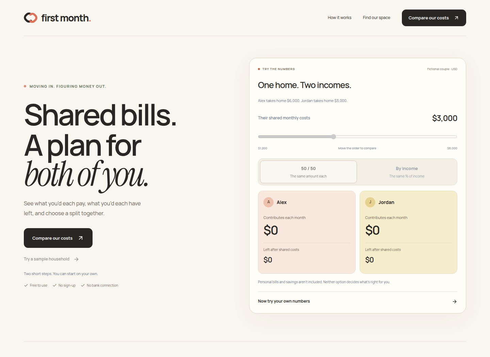
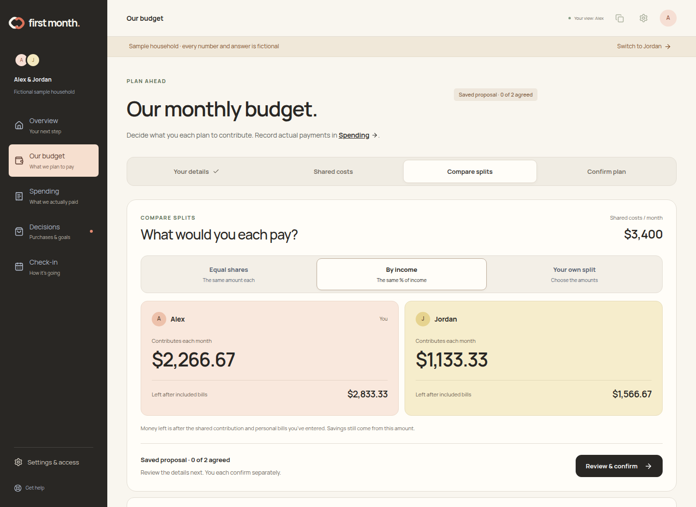
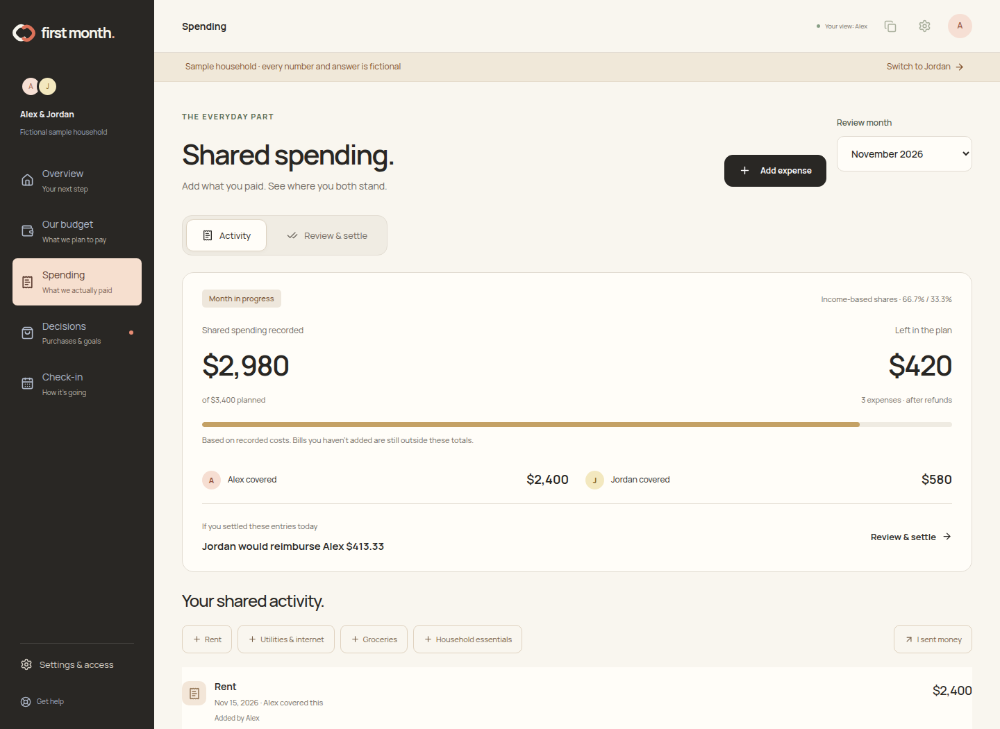
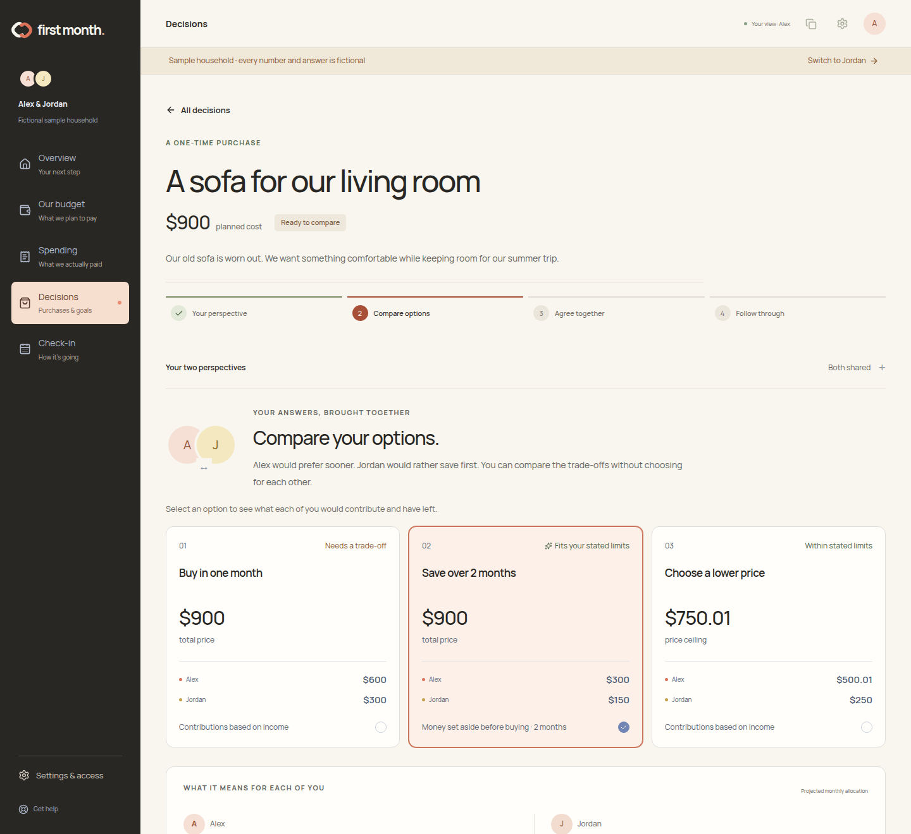
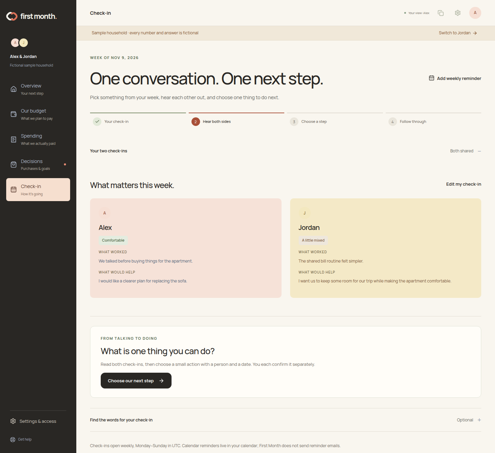
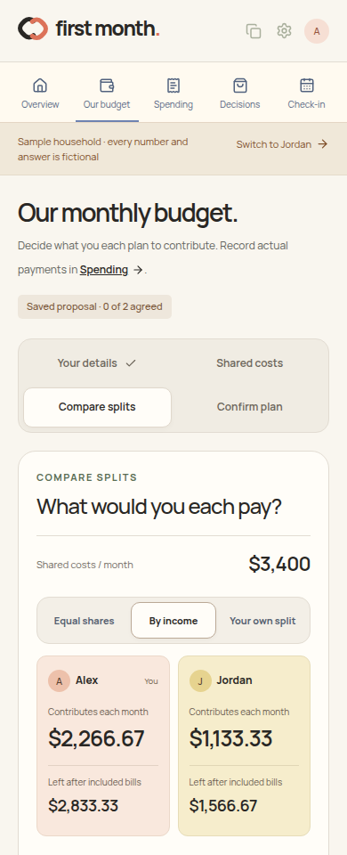
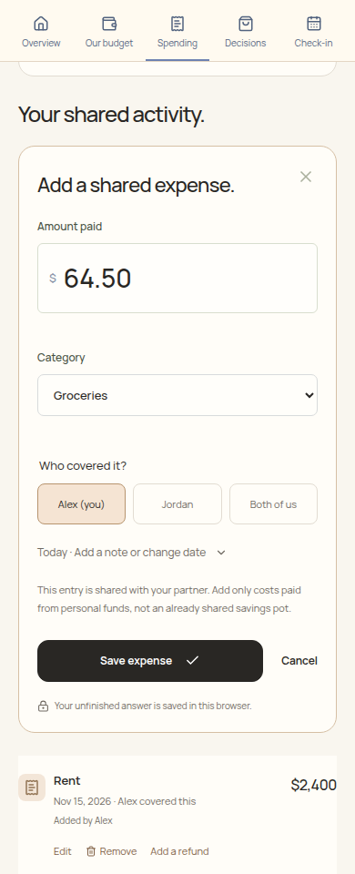
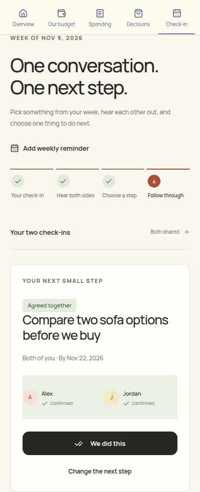

<div align="center">
  
  <h1>First Month</h1>
  <p><strong>Shared bills. A plan for both of you.</strong></p>
  <p>Agree on the money side of moving in together — and keep the plan working afterward.</p>
  <p>
    <a href="https://first-month-six.vercel.app"><strong>Open the live app →</strong></a>
    &nbsp; · &nbsp;
    <a href="#try-it-in-two-minutes">Try the demo</a>
    &nbsp; · &nbsp;
    <a href="docs/DEVELOPMENT.md">Run locally</a>
    &nbsp; · &nbsp;
    <a href="docs/RELEASE-CHECK.md">Release checks</a>
  </p>
  <p><sub>Money track · B2C · US couples · Browser-based · Free release</sub></p>
</div>

[](https://first-month-six.vercel.app)

## Moving in brings a lot to agree on

Rent is only the beginning. Two people also need to decide which costs are shared, how much each contributes, who pays, and what happens when the plan changes.

**First Month turns those decisions into a shared routine.** Each person adds their own perspective, compares the numbers, and confirms the same version. Afterward, they can record actual spending, plan a purchase, and choose a concrete next step at their weekly check-in.

No account creation. No bank connection. Each partner has their own private access link.

## Try it in two minutes

1. **[Open First Month](https://first-month-six.vercel.app)** and choose **Try a sample household**. Alex and Jordan's data is explicitly fictional; your demo gets its own space.
2. In **Our budget**, switch between equal and income-based contributions. See what each person contributes and has left.
3. Open **Decisions → A sofa for our living room**. Compare buying now, saving first, and changing the price or split. Propose an option.
4. Use **Switch to Jordan** in the sample banner to try the other person's perspective and confirmation.
5. Visit **Spending** for recorded costs, or **Check-in** to turn a conversation into one action with an owner and a date.

To try your own numbers, choose **Compare our costs**. The starting comparison takes two steps; saving it creates a space you can invite your partner into. Save your personal link somewhere private.

## From the first plan to the next month

| Where | What you get | What brings you back |
| --- | --- | --- |
| **Our budget** | Equal, income-based, or custom contributions; money left for each person; a printable agreement. | A change in income, shared costs, or priorities. |
| **Spending** | Expenses, refunds, confirmed reimbursements, and a joint month-end review. | The next shared bill and settling the month together. |
| **Decisions** | Private perspectives, calculated purchase options, a savings schedule, and separate approvals. | A purchase to discuss or a goal to fund. |
| **Check-in** | A topic from your week, two perspectives, and one agreed action with an owner and a date. | Following through, then deciding what to adjust. |
| **Overview** | One next action based on your household's current state. | Knowing what needs your attention today. |

**Compare → agree together → record real costs → check in → adjust the next month.**

## A look inside

<table>
  <tr>
    <td width="50%"><a href="docs/images/budget.png"></a></td>
    <td width="50%"><a href="docs/images/spending.png"></a></td>
  </tr>
  <tr>
    <td><strong>A budget you both understand.</strong><br />Try a split before saving it. Each person confirms separately.</td>
    <td><strong>See how the month is actually going.</strong><br />Record who paid and compare actual costs with the plan.</td>
  </tr>
  <tr>
    <td><a href="docs/images/decisions.png"></a></td>
    <td><a href="docs/images/checkin.png"></a></td>
  </tr>
  <tr>
    <td><strong>Make room for both perspectives.</strong><br />Compare timing, contributions, and existing commitments.</td>
    <td><strong>Leave the conversation with a next step.</strong><br />Agree on what to do, who will do it, and by when.</td>
  </tr>
</table>

<details>
  <summary><strong>See the mobile experience</strong></summary>
  <br />
  <p align="center">
    
    &nbsp;
    
    &nbsp;
    
  </p>
</details>

<sub>Actual application screenshots using the labelled sample household. Click a desktop image to view it at full size.</sub>

## Built around two separate voices

- **Sharing is a choice.** Personal profiles and conversation answers stay private until the relevant answers are shared by both people. An estimated partner income stays private to its author.
- **Agreement needs two confirmations.** One person cannot approve for the other. Changing financial terms resets approvals; stale updates are rejected.
- **Money calculations use exact cents.** Split comparisons, refunds, savings schedules, and reimbursements run in deterministic code.
- **Plans and payments have separate records.** Agreeing to buy a sofa creates a commitment. An expense is recorded only when someone enters an actual payment. A reported transfer counts after its recipient confirms receipt.
- **Your work survives interruptions.** Browser drafts preserve unfinished answers. Repeated expense submissions use stable IDs to avoid duplicate entries.
- **Your data stays accessible.** Download a personal-link backup, export your permitted records, print an agreement, replace your link, or delete the shared household.

## Conversation help, when you want it

Optional generated guides use the context both partners have shared to suggest **three discussion questions and an opening sentence**. Budget arithmetic and approvals stay in application code.

Groq is configured on the server; an OpenAI alternative is supported. The interface shows a real pending state, a generated result, or a recoverable error. No canned response substitutes for an unavailable model. Notes and selected topics are sent only when a guide is requested; free-text context can contain amounts.

## Under the hood

| Layer | Implementation |
| --- | --- |
| Interface | React 19, TypeScript, App Router conventions, local fonts, responsive CSS |
| Application runtime | Vinext on a Cloudflare Worker |
| Persistence | Cloudflare D1, schema migrations, revision-checked writes |
| Public URL | Vercel entry point forwarding to the existing Worker |
| Money logic | Framework-independent JavaScript modules and exact-cent calculations |
| Conversation generation | Groq; optional OpenAI alternative; validated structured output |
| Access | Separate random personal tokens, hashed server-side; single-use invitation |

Read the [architecture and boundaries](docs/ARCHITECTURE.md) for data visibility, concurrency, hosting, and financial assumptions.

## Run it locally

Requires **Node.js 22.13+** and npm.

```sh
git clone https://github.com/amurapan/first-month.git
cd first-month
npm --prefix web run install:ci
npm run build
```

Then [initialize the local database](docs/DEVELOPMENT.md#initialize-the-local-database) and run `npm run dev`. The complete setup, optional model configuration, verification commands, and screenshot script are in [Development](docs/DEVELOPMENT.md).

```sh
npm test
node web/node_modules/typescript/bin/tsc -p web/tsconfig.json --noEmit
```

The [release report](docs/RELEASE-CHECK.md) records the API and browser scenarios checked, accessibility findings, and remaining submission work.

## Product and research status

The current release is **free**. Payments, subscriptions, bank connections, and outgoing email are not enabled.

The business hypothesis is a subscription per household for ongoing coordination: a shared budget, monthly reconciliation, purchase planning, and recurring check-ins. Pricing, conversion, retention, and acquisition economics still need real-user validation. Inviting a partner helps activate a household; it does not by itself prove low acquisition cost.

Seven public accounts informed the initial moving-in scenario. They are secondary research. **No customer interviews, paid conversions, or participant usability studies are claimed.** See the [research findings](research/findings-ru.txt), [source records](research/evidence.csv), and [prepared interview script](research/interview-en.txt).

---

[Live app](https://first-month-six.vercel.app) · [Privacy](https://first-month-six.vercel.app/privacy) · [Terms](https://first-month-six.vercel.app/terms) · [Contact](mailto:kudomiya@proton.me)
