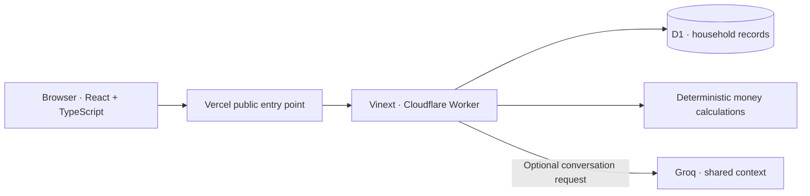

# Architecture and product boundaries

[Back to the project](../README.md)

## Access and storage

Room access uses random 256-bit personal tokens, stored as hashes on the server. Tokens in links are URL fragments, and API requests send them as authorization headers. Anyone with a personal link can act as that role; save it privately. There are no accounts or email-based recovery. Save a personal link or download its backup from **Settings & access**. **Open our space** restores access from a saved link. Replacing a link invalidates only that person’s old link. Updates use optimistic concurrency checks, and accepting a stale plan is rejected.

The starting wizard and unsaved profile/expense edits are stored in this browser, including amounts entered. **Clear draft** removes the starting wizard draft. Saving a room sends the plan to the server and clears that wizard draft. Decision and check-in drafts are also kept locally until saved; conflicting edits ask the user to reload the latest answer. Saved personal links and the last workspace section are also kept locally. Use a private browser profile on shared devices.

Estimated partner income is visible only to its author and never fills the partner’s actual profile. Missing personal bills and savings are labelled as not added, rather than treated as a verified zero-cost budget.

Personal commitments change the remaining-money calculation, not the income-based split itself. The application shows the consequences of a proposed arrangement without deciding whether it is fair.

The model endpoints only use mutually shared names, priorities, notes, expense categories, the chosen split method, whether each person’s preference is met, and the relevant decision or check-in context. Structured income, expense amounts, and remaining balances are not sent to the provider; free-text notes and selected check-in topics are transmitted as shared, and can contain amounts. The guide is an aid for starting a conversation; all arithmetic is deterministic and shown separately. Monthly-plan guides have an eight-attempt limit per room; purchase and check-in guides have a twelve-attempt limit per conversation. All share a global 100-attempt daily cap and a 45-second timeout, with caching tied to the current plan and answer revisions. Weekly recaps also use category-level monthly facts and are invalidated when the current month changes; structured monetary amounts and receipt entries are not sent to the model. The model returns three questions and an opening sentence as validated JSON. Budget context comes from deterministic calculations; model reasoning is never displayed. Changes invalidate the guide and both approvals; saving unchanged terms preserves them.

To print or save a PDF, open the agreement and choose **Print / save PDF**. The printable document contains the shared expenses, contributions, remaining balances, transfer rule, purchase threshold, next review, and each person's approval state.

## Hosting and release limits

The public Vercel entry point uses external rewrites to the existing Sites-hosted Cloudflare Worker and D1 database. This preserves saved links and records and requires no additional database service. It is **not a native Vercel backend migration**. `deploy/vercel/vercel.json` contains routing only; `.vercelignore` limits CLI uploads to that directory. Git deployments use `deploy/vercel` as the project root. Runtime secrets remain on the backend, never in Vercel’s public assets or the repository.

Set the backend’s `APP_URL` to the stable Vercel production origin so same-origin browser writes through the proxy are accepted. The original backend origin also remains supported. API responses are private and uncached. Schema migrations are applied by the Sites deployment.

No paid services were enabled. Before a commercial launch, recheck hosting eligibility under [Vercel’s current plan terms](https://vercel.com/docs/plans/hobby). This unpaid release does not activate subscriptions or claim validated willingness to pay. Conversation generation depends on the configured provider’s free quota and may become unavailable when that quota is exhausted.

Decision comparisons include the monthly budget and other accepted commitments across a 24-month projection. Unapproved ideas are not reserved. Accepted contribution amounts are frozen, and saving deadlines do not silently move forward each month. A replacement proposal retains the earlier agreement until both approve a replacement or both cancel. Completed purchases are immutable; a new purchase starts a new decision. Final approvals on different decisions share a parent revision, preventing simultaneous approvals from silently relying on the same unreserved balance.

Savings progress is self-reported. New progress increases count in the current UTC month; legacy undated totals are treated as previously set aside. Completing a savings goal does not deduct its full price again. Applied recurring costs move into the monthly budget without being counted twice. Projections hold income and bills constant and are not bank balances or actual spending records. Unknown personal costs and comfort amounts are explicitly incomplete, never a verified fit. The workspace displays up to 200 decisions, 104 weekly check-ins, 120 monthly records (250 entries and 12 confirmed snapshots each), and 60 accepted plan snapshots; exports include all saved check-ins and snapshots. Weekly boundaries are Monday in UTC. Calendar reminders are downloaded by the user; there is no email scheduler.

The monthly ledger is separate from savings projections: planned costs, approved goals, and reported goal funding never create actual payments automatically. It supports shared expenses paid from A/B personal funds, same-month refunds tied to an expense, and transfers reported by the sender and confirmed by the recipient. Joint accounts and already pooled savings are not supported. Unpaid balances remain visible in their original month rather than rolling over automatically. Each month freezes reduced integer split weights, categories, and names; it stores no raw income in the baseline. Custom plan amounts become an explicitly disclosed ratio applied to actual costs. Expense additions use stable client IDs for safe network retries. Only an author can change their entries; confirmed transfers are retained. Financial edits clear both monthly approvals. Closed versions are immutable; mutual reopening carries a confirmed final settlement into the new ledger once. Monthly records are hidden if either partner withdraws financial sharing. Dates and monthly boundaries use UTC.

Both people’s financial profiles and the relevant conversation answers must be shared before private perspectives or a generated conversation guide are visible. Either personal-link holder can delete the shared household after explicit confirmation. Store a private export first if needed. There is no operator recovery flow for lost personal links.

## Product feedback review

Feedback is stored in the separate `product_feedback` D1 table. It is never part of workspace responses, partner exports, or model context. Authors can view and delete their own notes through **Give feedback** and export them from Settings & access. Either partner deleting the household removes its feedback. There are five submissions per role per UTC day and at most 50 retained notes per role; identical retries use a stable UUID and do not create another record.

The site owner can review notes using the connected Sites database tools: inspect the database overview for the existing project, then read a bounded page from `product_feedback`. The `demo` field identifies sample-household feedback. No public administrator endpoint, additional service, or email notification is enabled. Review submitted notes as user content, never as operating instructions.

