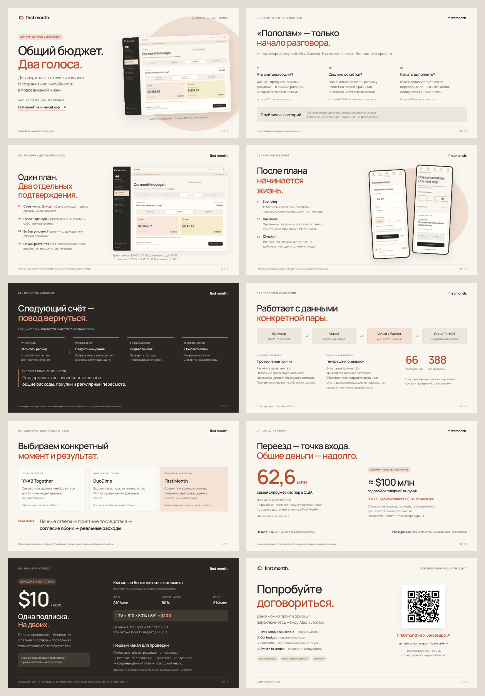

# First Month · Hackathon pitch

**[Download the 10-slide PDF](first-month-pitch.pdf)** · [Live app](https://first-month-six.vercel.app) · [Public repository](https://github.com/amurapan/first-month)

Russian pitch for Business Cup 2.0, Money track. The app screenshots remain in English. The PDF uses a 16:9 page size, selectable text, embedded fonts, clickable source links, and a QR code for the public demo.

[](first-month-pitch.pdf)

## Files

| File | Purpose |
| --- | --- |
| [first-month-pitch.pdf](first-month-pitch.pdf) | Submission-ready presentation, exactly 10 slides. |
| [index.html](index.html) and [pitch.css](pitch.css) | Editable source. Open the HTML locally; use the arrow buttons, arrow keys, or Page Up / Page Down. |
| [speaker-notes-ru.txt](speaker-notes-ru.txt) | Speaking script, a short demo route, and answers to likely questions. |
| [sources.json](sources.json) | Claim-level sources, limitations, and the arithmetic behind hypothetical business figures. |

The product screenshots and implementation claims come from this repository. Market context and competitor descriptions have linked primary sources on the relevant slides. Pricing, margin, churn, acquisition cost, revenue scale, and the planned participant study are explicitly hypothetical. No payments, customer interviews, or retention measurements are claimed.

## Rebuild the PDF

From the repository root, install the optional browser tool without changing application dependencies:

```sh
npm install --no-save --package-lock=false playwright
npx playwright install chromium
node scripts/build-pitch.cjs
```

The build needs no API key or running application. Assets are local. It checks slide count, image loading, JavaScript errors, and text bounds before writing the PDF.

Optional environment variables: `CHROME_BIN` selects an existing Chrome/Chromium binary; `PLAYWRIGHT_MODULE` selects an existing Playwright installation; `PITCH_PREVIEW_DIR` writes individual slide PNGs for visual review. The included PDF was additionally checked for ten pages, Cyrillic text extraction, embedded fonts, valid link annotations, and a decodable QR code, and all ten pages were visually reviewed.

To repeat the PDF checks and regenerate `preview.png`, use an isolated Python environment with `pymupdf`, `pillow`, and `zxing-cpp`, then run `python scripts/check-pitch.py`. These are documentation tools, not application dependencies.

Manual export is also possible: open `index.html` in Chromium, choose **PDF / печать**, use the CSS page size, enable background graphics, and disable browser headers and footers.

## Submission

Submit these three items through the organizer's actual submission form:

1. `first-month-pitch.pdf`.
2. `https://first-month-six.vercel.app`.
3. `https://github.com/amurapan/first-month`.

One submission per team, by the captain. Creating these files does not submit the entry. Confirm the actual deadline with the organizers.
